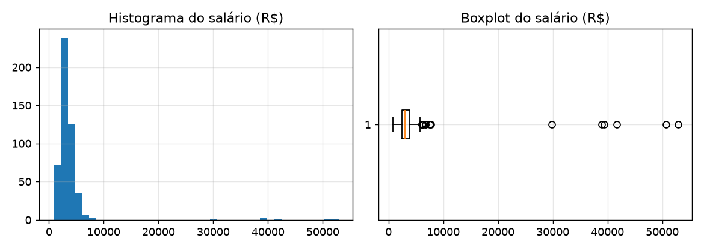
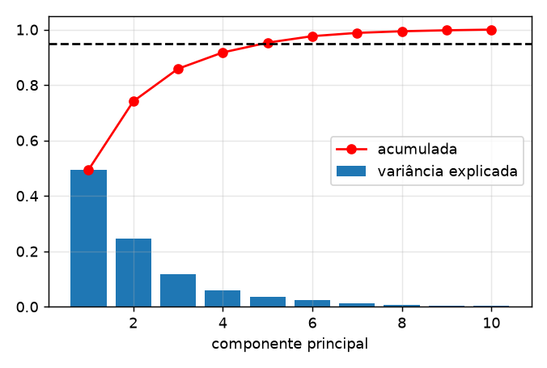

# Aula 3 do zero: arrumar os dados antes de ensinar a máquina (pré-processamento)

Este texto assume que você **sabe programar** e **não sabe nada de ciência de dados**. Cada ideia vem primeiro com uma analogia de software, depois com o termo técnico que a professora usa nos slides. As palavras em **negrito** são as que podem aparecer na prova. Os números de slide aparecem entre parênteses para você conferir no PDF dela.

Leia na ordem. No fim de cada seção há um "Se perguntarem na prova", que é o resumo do que precisa ficar.

Uma ideia atravessa a aula inteira e vale a pena guardar desde já: **tudo que o pré-processamento "aprende" dos dados (média, limites, categorias, escala) deve ser aprendido só com o conjunto de treino**. Voltamos a isso em quase todas as seções e fechamos na seção 18.

---

## 1. Por que pré-processar? (slide 3)

Pense em **validar e normalizar a entrada de uma API** antes de passá-la para a regra de negócio. Se você jogar na função dados com campos vazios, unidades misturadas e valores absurdos, ela vai devolver lixo, ou quebrar.

Com o aprendizado de máquina (AM) é igual. O slide 3 diz que, na maioria das vezes, **não é possível aplicar os algoritmos de AM diretamente sobre os dados**. As técnicas de pré-processamento servem para:

1. **Corrigir problemas** nos dados (falta de valores, valores absurdos, tipos incompatíveis);
2. **Tornar o conjunto mais adequado** ao algoritmo (escala parecida entre colunas, quantidade razoável de colunas, classes equilibradas).

O slide acrescenta um passo que muita gente pula: antes de mexer, faça uma **caracterização dos dados** e uma **exploração inicial** com **estatísticas descritivas básicas** (média, mediana, desvio padrão, mínimo, máximo) e/ou **visualizações básicas** (histograma, boxplot). É o equivalente a **olhar os logs e rodar um `SELECT ... LIMIT 20`** antes de escrever o ETL.

### O que a "caracterização" revela na prática (slide 3)

**Estatística descritiva** são os números que resumem uma coluna sem precisar olhar linha por linha: **contagem** (quantos valores existem), **média**, **mediana** (o valor do meio), **desvio padrão** (o quanto os valores se espalham), **mínimo** e **máximo**. Em Python, uma linha resolve: `df.describe()` (e `df.isna().sum()` conta os vazios por coluna). É o equivalente de rodar `COUNT`, `AVG`, `MIN`, `MAX` por coluna antes de escrever o ETL. O slide pede isso **antes** de qualquer tratamento, e o motivo é que cada número denuncia um problema diferente. Exemplo com a coluna "idade" de uma base de pacientes (valores ilustrativos meus):

| O que você vê | O que isso sugere | Tarefa do slide 5 que entra em jogo |
| :-- | :-- | :-- |
| Contagem menor que o número de linhas | Há **dados faltantes** na coluna | Tratar faltantes |
| Máximo = 200 numa coluna de idade | Valor impossível: **erro** ou outlier | Tratar outliers |
| Média (45) bem maior que a mediana (38) | Cauda longa à direita: **assimetria** (puxada por extremos) | Escolher IQR e não Z-score (seção 8) |
| Desvio padrão = 0 | A coluna tem o mesmo valor sempre: **irrelevante** | Seleção de atributos |
| Uma coluna vai de 0 a 1 e outra de 0 a 50.000 | **Escalas muito diferentes** | Mudança de escala |
| Uma classe com 80% das linhas | Base **desbalanceada** | Balanceamento |

**Visualização básica** é o mesmo papel em forma de desenho: o **histograma** mostra o formato da distribuição e o **boxplot** mostra mediana, quartis e pontos soltos (seção 5). **Analogia de software:** é o *dashboard* de saúde do dado, parecido com olhar o painel de métricas antes de decidir onde otimizar. Pular essa etapa é "refatorar sem profiler": você trata o que imagina, não o que existe. O slide ainda diz que isso garante **qualidade e facilidade de interpretação** dos resultados, ou seja, também serve para você explicar depois por que o modelo se comportou de certo jeito.

> **Se perguntarem na prova:** pré-processar serve para corrigir problemas e adequar os dados ao algoritmo; antes dele, convém caracterizar e explorar os dados com estatística descritiva e gráficos.

---

## 2. Integração de bases (slide 4)

Empresas e órgãos de governo costumam ter os dados **espalhados em mais de uma base** ou tabela atributo-valor (aquela tabela de linhas e colunas da Aula 1). O algoritmo de AM quer **uma tabela única**. Então é preciso **integrar** (juntar) as bases.

**Analogia de software:** é um `JOIN` (ou um *merge* de dois sistemas legados). Quem já migrou dados de dois sistemas sabe que juntar não é só concatenar. O slide avisa que a integração **pode levar a inconsistências e redundâncias**:

- **Inconsistência**: a *mesma* informação aparece com **valores ou formatos diferentes** em cada base, ou valores que se contradizem.
- **Redundância**: a *mesma* informação aparece **repetida**, em linhas duplicadas ou em colunas que dizem a mesma coisa.

Exemplo concreto. A secretaria acadêmica tem o sistema A (matrículas) e o sistema B (financeiro):

| Sistema A: aluno | Sistema A: sexo | Sistema A: altura | Sistema B: aluno | Sistema B: sexo | Sistema B: altura |
| :-- | :-- | :-- | :-- | :-- | :-- |
| Ana Souza | F | 1,65 (metros) | ANA SOUZA | Feminino | 165 (centímetros) |

- "Ana Souza" × "ANA SOUZA" e "F" × "Feminino": o mesmo valor escrito de formas diferentes, então um programa pode achar que são pessoas ou categorias diferentes. **Inconsistência de formato/codificação.**
- 1,65 × 165: **unidades diferentes**. Se você somar as duas bases, a altura média vira lixo. **Inconsistência de unidade.**
- Se a tabela integrada ficar com duas colunas de sexo e duas de altura, ou com Ana duas vezes, há **redundância**.

> **Se perguntarem na prova:** integrar bases = juntar várias fontes numa só tabela; riscos = **inconsistências** (valores/formatos/unidades diferentes para o mesmo dado) e **redundâncias** (dados repetidos). Os slides só citam esses dois riscos; os exemplos acima são ilustrações minhas.

---

## 3. As seis tarefas de pré-processamento (slide 5)

O slide 5 lista as **principais tarefas**. Decore a lista, porque a prova pode perguntar "qual destas **não** é uma tarefa de pré-processamento":

| # | Tarefa | Em uma frase |
| :-- | :-- | :-- |
| 1 | **Tratar dados faltantes** | Células vazias: o que fazer? (seção 4) |
| 2 | **Tratar outliers** | Valores muito fora do padrão (seções 5 a 9) |
| 3 | **Mudança de escala** | Colocar colunas numéricas em escalas comparáveis (seções 10 e 11) |
| 4 | **Mudança de tipo** | Texto → número (seção 12) e número → faixas/rótulos (seção 13) |
| 5 | **Redução de dimensionalidade** | Ter menos colunas (seções 14 a 16) |
| 6 | **Balanceamento da base** | Equilibrar a quantidade de exemplos por classe (seção 17) |

**Não são** pré-processamento: treinar o modelo, ajustar hiperparâmetros, calcular acurácia. Essas são etapas **depois** (lembra das 7 etapas da Aula 1? Preparação vem antes de seleção do modelo, treinamento e avaliação).

> **Se perguntarem na prova:** faltantes, outliers, escala, tipo, dimensionalidade, balanceamento.

---

## 4. Dados faltantes (slide 6)

**Dado faltante** (*missing value*) é quando **falta o valor de algum atributo em alguma amostra**: a célula está vazia (`NULL`, `NaN`, `""`).

**Analogia:** campo opcional de um formulário que o usuário não preencheu. Seu código precisa decidir o que fazer com o `null`. O slide 6 dá **sete alternativas**. Vamos usar esta tabela de pacientes para ilustrar:

| Id | Idade | Peso | Fumante | Cor do cabelo | Diagnóstico |
| :-- | :-- | :-- | :-- | :-- | :-- |
| 1 | 52 | 80 | sim | (vazio) | doente |
| 2 | 31 | (vazio) | não | castanho | saudável |
| 3 | (vazio) | 90 | sim | (vazio) | doente |
| 4 | 45 | 70 | (vazio) | preto | saudável |

### As sete alternativas

1. **Eliminação do atributo (coluna).** Joga a coluna toda fora. Serve quando a coluna tem **muitos** vazios e/ou é irrelevante. Aqui, "Cor do cabelo" tem 2 vazios em 4 e provavelmente nem influencia o diagnóstico. **Risco:** perder uma coluna que era útil.
2. **Eliminação do exemplo (linha).** Joga a linha fora. Serve quando **poucas linhas** têm vazios e sobram muitas. **Risco:** perder dados valiosos; se a base é pequena, ela encolhe demais; se os vazios não são aleatórios (por exemplo, só quem é muito doente deixa o campo vazio), você **enviesa** a amostra.
3. **Preencher manualmente.** Alguém descobre e digita o valor real (ligar para o paciente). É o mais fiel, mas **não escala** em bases grandes.
4. **Utilizar alguma heurística.** Uma regra de negócio que você escreve (por exemplo, "se o peso falta, use o peso da última consulta"; "se falta o estado, deduza do CEP"). **Risco:** a regra pode estar errada ou criar viés.
5. **Preencher com um valor que indique ausência.** Você usa uma marca como `"desconhecido"` ou `-1` para dizer "não sei". Útil quando **a própria ausência é informação** (quem não informa renda talvez tenha um perfil). **Risco:** para um algoritmo numérico, `-1` é um número de verdade e pode distorcer.
6. **Preencher com a média ou a moda do atributo.** **Média** para coluna numérica (idade vazia vira a idade média), **moda** (o valor mais frequente) para coluna simbólica (fumante vazio vira "não", se for o mais comum). Rápido e simples. **Risco:** todos os vazios viram o mesmo valor, o que **reduz a variabilidade** dos dados e ignora que cada paciente é diferente.
7. **Usar um algoritmo de AM para estimar o valor.** A coluna que tem vazios passa a ser o **atributo alvo** de um modelo, treinado com as linhas em que ela está preenchida; depois o modelo "prevê" os vazios. É o mais sofisticado. **Risco:** custo maior e o valor continua sendo uma estimativa.

**Analogia:** é o `COALESCE(campo, valor_padrao)` (alternativas 5 e 6) versus "recusar a requisição" (alternativa 2) versus "perguntar ao usuário" (alternativa 3) versus "inferir a partir de outros campos" (alternativas 4 e 7).

**Como escolher (regra prática):**

| Situação | Alternativa mais razoável |
| :-- | :-- |
| Coluna quase toda vazia ou irrelevante | Eliminar a coluna |
| Poucas linhas com vazio, base grande | Eliminar as linhas |
| Poucas linhas, valor importante e verificável | Preencher manualmente |
| Coluna numérica com poucos vazios | Média (ver observação abaixo) |
| Coluna simbólica com poucos vazios | Moda |
| A ausência em si tem significado | Valor indicador de ausência |
| Dado valioso, muitos vazios, outras colunas explicam | Algoritmo de AM |

**Observação sobre média e treino/teste.** A média (ou a moda) usada para preencher deve ser **calculada só com o conjunto de treino** e depois **aplicada** ao teste. Se você calcular com a base inteira, informação do teste "vaza" para o treino (isso se chama **vazamento de dados**, *data leakage*; detalhes na seção 18). Os slides não detalham isso nesta parte, mas é a regra geral.

⚠ **Divergência com a literatura.** Em colunas numéricas com outliers, a literatura costuma preferir a **mediana** à média (a média é arrastada pelos extremos). O slide só cita média e moda; na prova, responda com **média ou moda**, e se a questão trouxer "mediana", saiba que é uma alternativa legítima.

> **Se perguntarem na prova:** as sete alternativas são: eliminar coluna, eliminar linha, preencher manualmente, heurística, valor indicador de ausência, média/moda, algoritmo de AM. Média serve para numérico, moda para simbólico.

---

## 5. Outliers e ruído (slides 7 e 8)

**Ruído** é o dado que contém objetos que, aparentemente, **não pertencem à distribuição que gerou os dados**. O slide define ruído como uma **variância ou erro aleatório** no valor gerado ou medido para um atributo.

Traduzindo: é um valor que **não combina** com o resto, por erro de digitação, sensor com defeito ou algo realmente raro.

**Outlier** (valor atípico, "ponto fora da curva") é o **indicador** de possível ruído: **um valor muito diferente dos demais**. Exemplo do slide 7: um atributo cujo intervalo típico está entre 30 e 50, mas existe uma amostra com valor **200**.

**Analogia de software:** o tempo de resposta de um endpoint costuma ficar entre 30 e 50 ms, e um dia aparece uma requisição com 200.000 ms. Pode ser um bug de medição (ruído), ou um incidente real (dado legítimo e raro). **Outlier não é sinônimo de erro**: o slide diz "um indicador da *possível* presença de ruído". Por isso é preciso **decidir** o que fazer (seção 9) em vez de apagar às cegas.

### Como enxergar outliers (slide 8: figuras)

Duas ferramentas de visualização, que você precisa saber ler:

- **Histograma**: barras que contam quantas amostras caem em cada faixa de valores. Outliers aparecem como **barrinhas isoladas, longe da massa principal**.
- **Boxplot** ("diagrama de caixa"): a **caixa** vai de **Q1 a Q3** (os 50% centrais dos dados), a **linha dentro da caixa** é a **mediana**, os "bigodes" se estendem até os limites calculados pela regra do IQR (seção 7) e os **círculos além dos bigodes** são os **outliers**.

Veja um exemplo real da nossa base de estudo, de salários:



Leitura: quase todo mundo ganha entre R$ 2 mil e R$ 6 mil; porém há cinco pontos soltos entre cerca de R$ 30 mil e R$ 53 mil. O histograma mostra uma **cauda comprida para a direita** (distribuição **assimétrica**) e o boxplot mostra vários círculos além do bigode direito. Dados do gráfico: **média ≈ R$ 3.666**, **mediana ≈ R$ 3.035**. Repare: **a média é maior que a mediana**, porque os valores gigantes **puxam a média para cima**; a mediana não se mexe quase nada. Isso será a chave da seção 8.

> **Se perguntarem na prova:** ruído = erro/variância aleatória que não pertence à distribuição; outlier = valor muito diferente dos demais, **indicador** de possível ruído (não necessariamente erro). Dá para ver em histograma e boxplot.

---

## 6. Método Z-score (slide 9)

O **Z-score** responde: **"a quantos desvios padrão este valor está da média?"**

- **Média (μ)**: o "centro" dos dados.
- **Desvio padrão (σ)**: o tamanho típico do "afastamento" em relação à média. Se σ é pequeno, os dados são bem agrupados; se é grande, são espalhados.
- Fórmula: **Z = (valor − média) ÷ desvio padrão.** Sem pânico: na prova não há cálculo; basta saber o significado. Z = 0 é exatamente a média; Z = 2 é "dois desvios acima"; Z = −1,5 é "um desvio e meio abaixo".

**Analogia:** é como medir a latência em "unidades de variação normal da sua API". Dizer "200 ms" não diz se é muito; dizer "está a 6 desvios padrão da média" diz que é muito atípico.

### A regra 68-95-99,7 (distribuição normal)

Se os dados têm a forma de **sino** (**distribuição normal**: simétrica, com a maioria perto do centro), o slide diz:

| Intervalo | % dos dados dentro |
| :-- | :-- |
| Z entre **−1 e 1** | **68%** |
| Z entre **−2 e 2** | **95%** |
| Z entre **−3 e 3** | **99,7%** |

Ou seja, só **0,3%** dos valores fica além de ±3 desvios. Por isso a regra de corte do slide: **qualquer valor com Z > 3 ou Z < −3 é considerado outlier.**

Exemplo qualitativo: numa turma, as alturas têm média 1,70 m e σ = 0,07 m. Uma pessoa com 2,15 m está a mais de 6 desvios: outlier. Uma com 1,85 m está a pouco mais de 2 desvios: alta, mas **não** outlier pelo corte de 3.

⚠ **Pegadinhas:** (1) o corte é **3**, não 2 (com 2, você marcaria ~5% dos dados normais como "outlier"); (2) os valores 68, 95 e 99,7 valem para a **distribuição normal**, e é por isso que o Z-score funciona melhor com dados em forma de sino.

> **Se perguntarem na prova:** Z-score = quantos desvios padrão do ponto à média; 68% / 95% / 99,7% para ±1 / ±2 / ±3; outlier = |Z| > 3.

---

## 7. IQR e a regra de 1,5 × IQR (slides 10 e 11)

O outro método não usa média nem desvio padrão, usa **posições** (quartis).

Ordene os valores do menor ao maior e divida em quatro fatias de tamanho igual:

- **Q1** (primeiro quartil): o valor abaixo do qual estão **25%** dos dados.
- **Q2**: a **mediana** (50%).
- **Q3** (terceiro quartil): o valor abaixo do qual estão **75%** dos dados.

O **IQR** (*Interquartile Range*, intervalo interquartílico) é **IQR = Q3 − Q1**: a **largura do "miolo"**, os 50% centrais. Diferente da amplitude total (máximo − mínimo), o IQR **ignora as pontas**, por isso o slide o chama de ferramenta favorita contra outliers.

**Analogia:** é como o **p25 e p75 de latência** em vez do máximo. O máximo é sensível a um pico bizarro; o miolo, não.

### A regra de 1,5 × IQR (slide 11)

Define-se a **cerca** do que é aceitável:

- **Limite inferior = Q1 − 1,5 × IQR**
- **Limite superior = Q3 + 1,5 × IQR**

Qualquer valor **fora** desses limites é outlier. É exatamente isso que o boxplot desenha: a caixa é Q1 a Q3 e os bigodes vão até as cercas.

No exemplo do salário, Q1 ≈ 2.422 e Q3 ≈ 3.847, então IQR ≈ 1.424 e o **limite superior ≈ R$ 5.983**. Quem ganha mais que isso é outlier (e, por isso, no boxplot há círculos já a partir de uns R$ 6 mil, além dos cinco bem distantes). O limite inferior fica em torno de R$ 286, e ninguém ficou abaixo dele, então não há outliers "para baixo".

⚠ **Pegadinha:** a regra usa **1,5** (não 3) e é **×IQR**, somada a **Q3** e subtraída de **Q1** (não da média).

> **Se perguntarem na prova:** IQR = Q3 − Q1 (os 50% centrais); limites Q1 − 1,5×IQR e Q3 + 1,5×IQR; fora disso = outlier.

---

## 8. Z-score ou IQR: qual usar? (slide 12)

O slide dá a regra de bolso:

| | **Z-score** | **IQR** |
| :-- | :-- | :-- |
| Use quando | Os dados seguem a **distribuição normal** (sino, simétrica) | Os dados são **assimétricos**, ou você **não sabe** a distribuição |
| Baseia-se em | **Média** e desvio padrão | **Mediana** e quartis |
| Qualidade | Mais sensível e preciso em distribuições simétricas | Mais **robusto** |

**Por que o IQR é "robusto"?** Porque a mediana e os quartis **não são arrastados por um valor extremo**; já a **média** (e o desvio padrão), que alimentam o Z-score, **são**. Imagine a nota média da turma: se um aluno tirar 1.000.000 por erro de planilha, a média vai para o espaço, mas a **mediana quase não muda**.

Isso tem uma consequência curiosa: o próprio outlier "desmancha" o Z-score, porque ele infla a média e o desvio padrão e, assim, **esconde a si mesmo e a seus vizinhos**. Nos dados de salário (assimétricos, com cauda), o IQR marcou **16** valores como outliers e o Z-score com corte em 3 marcou só **6**. Na distribuição assimétrica, o IQR é quem pega mais.

### A ligação que falta: assimetria, média e a escolha do método (slide 12)

Junte três fatos e a regra do slide deixa de ser decoreba:

1. **Assimetria** é quando a distribuição tem uma **cauda comprida** para um lado (o histograma do salário da seção 5 tem cauda à direita). Nela, a **média é puxada para a cauda** e fica longe da **mediana**.
2. O Z-score é calculado com **média e desvio padrão**, justamente as duas medidas que o extremo mais distorce. Ele "mede a distância até um centro" que já foi arrastado, e o σ inflado deixa a régua larga demais.
3. O IQR é calculado com **quartis**, que dependem da **posição** dos valores e não do tamanho deles: trocar 200 por 2.000.000 não muda nenhum quartil.

**Exemplo pequeno (números meus, para você enxergar o efeito).** Dez tempos de resposta em ms: 10, 10, 11, 11, 12, 12, 12, 13, 13 e **200**.

| Método | Cálculo (resumo) | Marca o 200 como outlier? |
| :-- | :-- | :-- |
| **Z-score** | média ≈ 30,4; desvio padrão ≈ 59,6; Z do 200 ≈ (200 − 30,4) ÷ 59,6 ≈ **2,8** | **Não** (2,8 < 3) |
| **IQR** | Q1 ≈ 11; Q3 ≈ 12,75; IQR ≈ 1,75; limite superior ≈ 12,75 + 1,5 × 1,75 ≈ **15,4** | **Sim** (200 > 15,4) |

O outlier **inflou a média e o σ e escondeu a si mesmo**: foi o que a frase "o próprio outlier desmancha o Z-score" quis dizer. O IQR, que olha o miolo, o pega sem esforço. (Detalhe de curiosidade, fora dos slides: com poucas amostras, existe um teto matemático para o Z de qualquer ponto, por isso o Z-score é ainda pior em bases pequenas.)

**Regra de decisão resumida:** não sabe se os dados têm forma de sino, ou vê cauda no histograma → **IQR**. Dados aproximadamente simétricos e em forma de sino → **Z-score** (a regra 68-95-99,7 só vale para a normal) ou IQR, ambos funcionam. Na dúvida, IQR.

> **Se perguntarem na prova:** Z-score → dados normais/simétricos; IQR → assimétricos ou distribuição desconhecida, e é mais robusto porque mediana e quartis não são afetados por extremos, ao contrário da média.

---

## 9. Outliers: o que fazer? (slide 13)

Achou o outlier? O slide diz que há **pelo menos três abordagens**:

### 9.1 Remoção
Apaga a linha. É a mais simples. **Quando serve:** o valor é claramente um **erro** (idade = 200 anos). **Risco:** se o valor era real, você joga fora informação, e se há muitos outliers a base encolhe.

### 9.2 Winsorização
Em vez de deletar a linha, você **"achata" os valores extremos para um limite máximo ou mínimo aceitável**. Exemplo do slide: se o limite superior do seu IQR é **5.000**, qualquer valor acima (digamos **100.000**) é transformado em **exatamente 5.000**.

**Analogia de software:** é um `clamp(valor, minimo, maximo)` ou um *rate limit* que corta o excesso. Você mantém a linha (e as outras colunas dela), só "amansa" o valor exagerado.

```python
limite_sup = 5000
df["salario"] = df["salario"].clip(upper=limite_sup)   # 100000 vira 5000
```

**Quando serve:** a linha tem outras informações úteis e você quer **reduzir o efeito** do extremo sem perder o exemplo.

### 9.3 Manter e usar algoritmos robustos
Não mexe no dado. Em vez disso, **escolhe um modelo que não se abala com outliers**. O slide cita: **Árvores de Decisão, Random Forest, Gradient Boosting (XGBoost/LightGBM)**. Árvores só fazem perguntas do tipo "valor > corte?", então um valor 100× maior cai no mesmo ramo que um valor "só" 2× maior.

**Quando serve:** o outlier é um dado **legítimo** (a fraude rara, o cliente VIP) e você não quer perdê-lo.

**Por que as árvores não se abalam (exemplo concreto).** Uma árvore de decisão aprende regras do tipo `if renda > 6.000`. Considere cinco clientes com rendas 2.000, 3.000, 4.000, 5.000 e **500.000**. O corte aprendido é, por exemplo, "renda > 4.500", e o cliente de 500.000 cai do lado "alto", **junto com o de 5.000**: para a árvore, só importa *de que lado do corte* ele está, não *o quanto* passou. Já uma **regressão linear** tenta traçar uma reta por todos os pontos e o ponto de 500.000 **puxa a reta inteira** na direção dele; o **k-NN** mede distâncias e o valor gigante vira um vizinho de ninguém. **Analogia de software:** a árvore se comporta como um `if` (só vê a comparação), a regressão linear como uma média ponderada (vê o tamanho). *Random Forest* e *Gradient Boosting* (XGBoost/LightGBM) são conjuntos de árvores, e herdam essa propriedade.

**Quando manter é a escolha certa:** quando o valor extremo é **real e importante** (fraude, falha rara, cliente de altíssimo valor, que é justamente o que o negócio quer detectar). Remover ou achatar apagaria o fenômeno que você quer prever. O vídeo "Excluir Outliers? Usar média ou mediana?" discute esse ponto de manter o outlier real e usar a mediana, em vez da média, para resumir os dados. Observe a troca de ferramenta: em vez de "arrumar o dado para caber no modelo", você "escolhe o modelo que cabe no dado".

### Regra final do slide: **trate outliers apenas no conjunto de treino**
Os limites (média e σ, ou Q1/Q3) devem ser calculados com o **treino**, e a limpeza é feita **no treino**. O teste deve continuar representando o **mundo real**, onde outliers existem e o modelo terá que lidar com eles. Se você "limpar" o teste, a nota na prova fica falsamente boa.

⚠ **Observação:** o slide diz "tratar outliers apenas no treino", não diz que os limites do teste sejam diferentes; a leitura usual é: calcular tudo no treino e **não remover linhas do teste**.

> **Se perguntarem na prova:** três abordagens = remover, winsorizar (achatar para o limite), manter com algoritmos robustos (árvores, Random Forest, Gradient Boosting). Tratar **só no treino**.

---

## 10. Mudança de escala (slides 14 a 17)

### O problema (slide 14)
Quando os atributos numéricos têm **escalas muito diferentes**, o algoritmo pode **classificar erroneamente com base apenas nos atributos de escala maior**.

**Exemplo.** Três pacientes: idade (anos) e renda (R$):

| Paciente | Idade | Renda |
| :-- | :-- | :-- |
| A | 30 | 3.000 |
| B | 31 | 4.000 |
| C | 60 | 3.100 |

Um algoritmo que mede **distância** (como o k-NN, visto adiante no curso) vai achar que A é muito mais parecido com C (renda quase igual, 100 de diferença) do que com B (idade quase igual, mas 1.000 de diferença na renda), embora C tenha o **dobro da idade**. A renda, por ter números enormes, **domina a conta**; os 30 anos de diferença viram "ruído". A idade foi, na prática, ignorada.

**Analogia de software:** é somar milissegundos com gigabytes numa mesma métrica. O que tem número maior "vence".

**A solução:** **normalizar** os dados para que todos os atributos fiquem **na mesma escala**.

### Duas técnicas (slides 15 e 16)

**Normalização por reescala (min-max)** (slide 15). Usa o **mínimo** e o **máximo** do atributo. Cada valor vira **(valor − mín) ÷ (máx − mín)**. Resultado: tudo fica **entre 0 e 1** (o menor vira 0 e o maior vira 1). É um "mapa linear" para o intervalo [0, 1].

**Normalização por padronização** (slide 16). Usa a **média** e o **desvio padrão** do atributo. Cada valor vira **(valor − média) ÷ desvio padrão**, que é... o próprio Z-score da seção 6! Resultado: o atributo passa a ter **média = 0** e **desvio padrão = 1**. A diferença destacada no slide: **a padronização não tem limite inferior nem superior fixos** (valores podem ser −3, 0,5, 4,2...), enquanto o min-max "achata" tudo entre 0 e 1.

| | **Min-max (reescala)** | **Padronização** |
| :-- | :-- | :-- |
| Usa | mínimo e máximo | média e desvio padrão |
| Resultado | intervalo fixo **[0, 1]** | **média 0, desvio padrão 1**, sem limite fixo |
| Sensível a outliers? | **Muito**: um extremo vira o máximo e espreme todo o resto perto de 0 | **Também**, pois média e σ são arrastados |

**Por que "o outlier esmaga o min-max":** se o salário vai de 1.000 a 50.000, mas 99% das pessoas ganham de 1.000 a 6.000, depois do min-max quase todo mundo fica entre 0 e ~0,1, "amontoado". O extremo roubou a escala. Isso leva à seção 11.

### Quais modelos se importam com a escala? (slide 17)
O slide 17 tem uma figura (que o texto extraído não captura) e a frase "**Baseados em gradiente:** regressão linear, regressão estatística, Naive Bayes".

- **Sensíveis à escala:** modelos que **medem distâncias** ou que **ajustam pesos por gradiente** (um procedimento de "descer a ladeira" para achar os melhores pesos, visto adiante no curso). Exemplos sólidos da literatura: **k-NN, K-means, SVM, redes neurais, regressão linear/logística, PCA**. Com colunas em escalas diferentes, o gradiente "anda torto" e a distância é dominada pelas colunas grandes.
- **Pouco sensíveis:** **árvores de decisão, Random Forest, Gradient Boosting**. Árvores só perguntam "coluna > corte?", e o corte é aprendido na escala da própria coluna, então a escala não importa.

**Por que cada família reage assim (exemplos):**

| Família | Algoritmos | Por que a escala importa (ou não) |
| :-- | :-- | :-- |
| **Distância** | k-NN, K-means (e SVM com kernel, que também usa distâncias) | Calculam "o quão longe" dois exemplos estão somando diferenças por coluna. Idade (diferença de 30) perde para renda (diferença de 1.000), como no exemplo da tabela acima. |
| **Gradiente** | regressão linear e logística, redes neurais (e a regressão do slide 17) | Aprendem os pesos por "descida de gradiente": dão passos pequenos para reduzir o erro. Se uma coluna vai de 0 a 1 e outra de 0 a 100.000, o peso da segunda precisa ser minúsculo e o da primeira grande; os passos servem para um e atrapalham o outro, e o treino fica **lento ou instável**. **Analogia:** é tentar afinar dois botões de um rádio em que um gira 100.000 vezes mais sensível que o outro. |
| **Variância** | PCA | Procura onde há mais variância; coluna em unidade grande "ganha" o PC1 só pela unidade (seção 16.4). |
| **Cortes por pergunta** | árvores, Random Forest, Gradient Boosting | Perguntam "coluna > corte?". Multiplicar a coluna por 1.000 só muda o número do corte, não a pergunta nem o resultado. **Não precisam de escala.** |

Dica de prova: se a questão pedir "qual algoritmo se beneficia de normalização", pense **"mede distância ou ajusta pesos por gradiente?"**. Se a resposta for sim, precisa; se o algoritmo só compara coluna com corte (árvore e derivados), não precisa. Se a alternativa disser que "árvores de decisão exigem normalização", está errada.

⚠ **Divergência com a literatura.** O slide inclui **Naive Bayes** na lista de "baseados em gradiente". Pela literatura, Naive Bayes **não** é um modelo de gradiente e, em geral, não depende da escala. Na prova, **responda como o slide** se a questão listar essa frase literalmente (regressão linear, regressão estatística e Naive Bayes como baseados em gradiente); e saiba que o ponto firme é: **modelos de distância e de gradiente pedem escala; árvores não**. Não consegui conferir a figura do slide 17: **a verificar** no PDF se ela cita outros modelos (provavelmente de distância).

> **Se perguntarem na prova:** escalas diferentes → o atributo de escala maior domina; normalizar = pôr tudo na mesma escala; min-max → [0, 1] com mín/máx; padronização → média 0 e desvio 1 com média/σ, sem limite fixo; árvores/Random Forest/Boosting não precisam.

---

## 11. Outliers × normalização: quem vem primeiro? (slide 18)

**Resposta do slide: trate (ou retire) os outliers primeiro, depois normalize.**

**Motivo:** min-max (usa mín e máx) e padronização (usa média e σ) são **extremamente sensíveis a valores extremos**. Se você normalizar antes, os extremos "contaminam" a escala inteira: o máximo vira o valor do erro, a média e o σ ficam inflados. E esses valores, no slide, "provavelmente são erros ou ruídos".

**Analogia:** é como **calibrar o gráfico de monitoramento** com um pico de 200.000 ms: a escala vertical fica gigante e a linha normal vira uma reta achatada embaixo. Primeiro você tira o pico (ou limita), depois ajusta a escala.

**Exemplo numérico (valores meus).** Salários 2.000, 3.000, 4.000, 5.000 e um erro de digitação de **500.000**. Com min-max **antes** de tratar: o 500.000 vira 1,0 e os outros ficam em 0,000; 0,002; 0,004; 0,006, todos esmagados colados no zero, e o modelo mal distingue 2.000 de 5.000. Tratando o erro **primeiro** (removendo-o, ou achatando-o ao limite do IQR), o min-max usa o intervalo 2.000 a 5.000 e os quatro valores ficam bem distribuídos: 0; 0,33; 0,67; 1,0. O mesmo vale para a padronização: o σ inflado pelo 500.000 faz todo mundo ter Z quase igual.

**Analogia de software:** é ordem de operações em um build. Você não calcula o *checksum* de um arquivo antes de corrigir o arquivo corrompido, porque o checksum do lixo não serve depois.

⚠ **Atenção: um vídeo da lista contradiz o slide.** No vídeo "Entendendo de vez a diferença entre normalização e padronização", o trecho por volta de 18:30 a 20:30 sugere que, mesmo com valores discrepantes, a padronização "não é afetada" e que o min-max "trava" os outliers. Isso **contraria o slide 18**, que diz que as duas técnicas são **extremamente sensíveis** a extremos (o exemplo numérico acima mostra o min-max sendo esmagado). Por isso esse trecho está marcado para não assistir. **Na prova, vale a versão do slide:** outliers primeiro, normalização depois, justificada por "a normalização é extremamente sensível a extremos". (A literatura também cita escalas robustas, que usam mediana e IQR e toleram melhor os extremos, mas elas não aparecem nos slides.)

Sequência correta para esse trecho:

```
1. (dividir treino/teste)  
2. tratar outliers NO TREINO
3. calcular min/máx (ou média/σ) NO TREINO, já sem os extremos
4. aplicar a mesma transformação ao treino e ao teste
```

> **Se perguntarem na prova:** primeiro outliers, depois normalização, porque a normalização é muito sensível a extremos; senão a escala fica contaminada.

---

## 12. Conversão simbólico → numérico (slides 19 e 20)

Alguns algoritmos **só lidam com números**. Se a base tem colunas de **texto/categoria** (**atributos simbólicos**), é preciso converter. A forma depende do **tipo** do atributo simbólico:

- **Ordinal**: há **ordem natural** entre os valores. Ex.: tamanho (P < M < G), escolaridade (fundamental < médio < superior), nível de satisfação.
- **Nominal**: **não há ordem**. Ex.: cor, cidade, curso, tipo sanguíneo.

### 12.1 Ordinal: inteiros ordenados
Pode-se fazer uma **conversão simples para inteiros que preservem a ordem** (slide 19):

| Tamanho | Número |
| :-- | :-- |
| P | 1 |
| M | 2 |
| G | 3 |

Faz sentido: G (3) > M (2) > P (1), e a ordem era real.

### 12.2 Nominal: por que NÃO usar inteiros arbitrários?
Imagine codificar a cor: vermelho = 1, azul = 2, verde = 3. Para o algoritmo, que só enxerga números:

- "verde" (3) é **maior** que "azul" (2) e que "vermelho" (1), mas essa **ordem não existe** na vida real;
- a **distância** entre vermelho e verde (2) é o dobro da distância entre vermelho e azul (1), como se azul fosse "mais parecido" com vermelho do que verde, o que também é inventado.

**Analogia de software:** é como usar `enum` com valores 1, 2, 3 e depois **calcular a média dos enums**: "a média entre vermelho e verde é azul". Não faz sentido.

O slide 19 resolve assim: converta **de forma que a diferença entre quaisquer dois valores do atributo seja sempre a mesma**.

### 12.3 One-hot encoding (slide 20)
A técnica é codificar cada valor nominal por **uma sequência de c bits, onde c é o número de valores possíveis** do atributo. Cada valor "acende" **um único bit** (daí *one-hot*, "um quente"):

| Cor | é_vermelho | é_azul | é_verde |
| :-- | :-- | :-- | :-- |
| vermelho | 1 | 0 | 0 |
| azul | 0 | 1 | 0 |
| verde | 0 | 0 | 1 |

Agora a **distância entre quaisquer duas cores diferentes é sempre a mesma**, e nenhuma "é maior" que a outra. O slide resume: *One-Hot Encoding transforma variáveis categóricas (nomes de cidades, cores, tipos de produto) em formato binário (0 e 1) que os algoritmos de ML conseguem processar matematicamente*.

**Custo:** uma coluna vira **c colunas**. Uma coluna "cidade" com 300 cidades vira 300 colunas. Isso conversa com a redução de dimensionalidade (seção 14).

```python
from sklearn.preprocessing import OneHotEncoder
enc = OneHotEncoder(handle_unknown="ignore")
enc.fit(X_train[["cor"]])                      # aprende as categorias só no treino
X_train_cor = enc.transform(X_train[["cor"]])
X_test_cor  = enc.transform(X_test[["cor"]])   # categoria nova no teste não quebra
```

⚠ **Pegadinha:** `LabelEncoder` (que dá 0, 1, 2... a cada categoria) em uma coluna **nominal** reproduz exatamente o erro dos inteiros arbitrários; só serve para o **ordinal** quando a ordem dos inteiros bate com a ordem real (e aí é melhor controlar a ordem explicitamente).

> **Se perguntarem na prova:** ordinal → inteiros ordenados; nominal → one-hot (c bits, um para cada valor), porque inteiros arbitrários **inventam ordem e distâncias** que não existem.

---

## 13. Conversão numérico → simbólico: discretização (slide 21)

O caminho inverso: transformar um **número contínuo em faixas com rótulo**. Chama-se **discretização**: define-se **intervalos** de valores e **cada intervalo recebe um rótulo**.

Exemplo: a idade (número) vira **faixa etária**:

| Idade (número) | Faixa (rótulo) |
| :-- | :-- |
| 0 a 17 | criança/adolescente |
| 18 a 59 | adulto |
| 60 ou mais | idoso |

**Analogia:** é o `switch`/`bucket` que agrupa números em categorias; também é o *binning* de um histograma.

**Quando serve:** algoritmos que só trabalham com atributos simbólicos, ou quando as faixas fazem mais sentido para o negócio. **Custo:** você perde precisão (27 e 55 viram os dois "adulto").

**Passo a passo do que o slide descreve** ("definir intervalos e dar a cada um um rótulo"): (1) escolha as **bordas** dos intervalos; (2) escolha o **rótulo** de cada intervalo; (3) cada valor recebe o rótulo do intervalo em que cai. Em pandas:

```python
import pandas as pd
bordas  = [0, 18, 60, 120]                     # 3 intervalos: [0,18) [18,60) [60,120)
rotulos = ["crianca/adolescente", "adulto", "idoso"]
df["faixa"] = pd.cut(df["idade"], bins=bordas, labels=rotulos, right=False)
```

`right=False` faz o intervalo incluir a borda esquerda (18 é "adulto", 60 é "idoso"). Pegadinha de qualquer discretização: **o que cai exatamente na borda** precisa ter regra definida, senão o mesmo valor pode ir para duas faixas ou para nenhuma. O resultado é uma coluna **simbólica**, que pode virar one-hot (seção 12) se o algoritmo exigir números. Com a estratégia de **larguras iguais** você não escolhe as bordas à mão: dá apenas o número de intervalos k e as bordas saem de (máx − mín) ÷ k a partir do mínimo (ex.: `pd.cut(df["idade"], bins=4)`). As bordas e o mínimo/máximo vêm **do treino**; uma idade nova no teste fora desse intervalo cai no primeiro ou no último intervalo (ou fica sem faixa, dependendo da ferramenta), por isso as bordas se definem só com o treino, como o resto da aula.

### Estratégias
O slide 21 lista **apenas uma**:

- **Larguras iguais**: divide o intervalo original (do mínimo ao máximo) em **subintervalos de mesma largura**. Ex.: valores de 0 a 100 em 4 faixas: 0-25, 25-50, 50-75, 75-100. **Fraqueza:** as faixas têm a mesma *largura*, mas podem ter **quantidades muito diferentes de exemplos** (a maioria pode cair em uma só faixa) e um outlier estica tudo.

Fora do slide (literatura, para você reconhecer o nome, não é cobrado pelo texto): **frequências iguais** (cada faixa com a mesma quantidade de exemplos) e discretização baseada em **agrupamento** (*clustering*). O slide indica "larguras iguais" como a estratégia da aula.

⚠ **Pegadinha de direção:** simbólico → numérico = codificação (ordinal/one-hot). **Numérico → simbólico = discretização.** Troque a direção e a questão fica errada.

> **Se perguntarem na prova:** discretizar = definir intervalos e dar um rótulo a cada um; estratégia citada: larguras iguais (subintervalos com a mesma largura).

---

## 14. Redução de dimensionalidade: por que ter menos colunas? (slides 22 a 25)

**Dimensão** = número de atributos (colunas). Dimensionalidade alta = muitas colunas.

**Intuição ingênua:** quanto mais atributos, melhor, pois há mais informação. O slide 22 diz que **na prática nem sempre é verdade**, por dois motivos:

1. **Maldição da dimensionalidade**: o **tempo computacional aumenta de forma considerável e indesejável** com o número de atributos, e isso dificulta construir o modelo.
2. **Atributos ruidosos, irrelevantes ou redundantes** podem **confundir** o algoritmo e **esconder** os poucos atributos realmente relevantes, prejudicando a acurácia do indutor.

### Maldição da dimensionalidade (slide 23)
Reforço do slide: **quanto mais features, mais amostras são necessárias**, porque é preciso ter exemplos suficientes para cobrir **todas as combinações possíveis** de valores e construir modelos que **generalizem**.

**Analogia:** testar um software com 2 flags booleanas exige 4 combinações; com 20 flags, mais de **1 milhão**. Se você só tem 100 casos de teste, a maioria das combinações nunca é vista. Com dados é igual: mais colunas, mais "cantos" do espaço sem exemplo nenhum.

### Vantagens × desvantagens (slide 25)

| | |
| :-- | :-- |
| **Vantagens** | O **custo de armazenamento** cai (o conjunto fica mais compacto); pode **aumentar o desempenho** dos modelos. |
| **Desvantagem** | **Perda de informações**: o modelo pode até ficar **pior** do que com a base original. |

> **Se perguntarem na prova:** a maldição da dimensionalidade = mais atributos → mais tempo e mais amostras necessárias; atributos irrelevantes/redundantes atrapalham. Reduzir tem vantagens (custo, às vezes desempenho) e desvantagem (perda de informação).

---

## 15. Seleção × agregação de atributos (slides 26 a 30)

O slide 26 divide as técnicas de redução em **duas grandes abordagens**:

| Abordagem | O que faz | Analogia |
| :-- | :-- | :-- |
| **Seleção de atributos** | **Escolhe um subconjunto** das colunas originais e **joga o resto fora** | `SELECT` só das colunas úteis |
| **Agregação de atributos** | **Combina** colunas para criar **novas** colunas mais representativas | Uma coluna calculada a partir de várias (`peso / altura²` resume duas colunas em uma) |

### 15.1 Seleção de atributos (slides 27 a 29)
O objetivo é manter só os **atributos relevantes**. Um atributo é **relevante** se é capaz de **distinguir exemplos de classes diferentes** (slide 27).

**Atributos irrelevantes** (slide 28): os que **não têm relação com o alvo**. No exemplo do slide (tabela de pacientes com diagnóstico), **Id** e **Nome** não contribuem. (Lembra da Aula 1: colunas de identificação são removidas, senão o modelo "decora" quem é quem.) Um **especialista da área** pode apontar quais atributos são relevantes.

**Atributos redundantes** (slide 29): a redundância tem duas faces.

- **Objeto (linha) redundante**: é **muito parecido com outro**, com valores quase iguais. Ex.: o mesmo aluno cadastrado duas vezes.
- **Atributo (coluna) redundante**: o valor, para todos os objetos, **pode ser deduzido de outro(s) atributo(s)** da base. Ex. do slide: **data de nascimento e idade** (uma deduz a outra). Outro: peso em kg e peso em libras.

Como detectar? **Análise de correlação** (mede o quanto dois atributos variam juntos, assunto de aulas seguintes): colunas muito correlacionadas são suspeitas de redundância.

**Analogia:** é remover **campos duplicados do schema** (normalização de banco de dados) e **colunas que não usa em nenhuma consulta**.

### 15.2 Agregação de atributos (slide 30)
**Combina duas ou mais variáveis para criar uma única medida mais representativa.** Diferente da seleção (onde você joga colunas fora), na agregação você **"funde"** informações com significados semelhantes, ou que **juntas contam uma história melhor do que separadas**. O algoritmo popular citado é o **PCA**.

### 15.3 Seleção × agregação com um exemplo só (slides 26 a 31)

Base de pacientes com as colunas: `id`, `nome`, `data_nascimento`, `idade`, `peso_kg`, `altura_m`, `diagnostico` (alvo).

| Ação | Tipo | Por quê |
| :-- | :-- | :-- |
| Remover `id` e `nome` | **Seleção** (irrelevantes, slide 28) | Não têm relação com o diagnóstico; só identificam a pessoa |
| Remover `data_nascimento` e ficar com `idade` | **Seleção** (redundante, slide 29) | Uma se **deduz** da outra: a informação é a mesma |
| Criar `imc = peso_kg / altura_m²` e descartar `peso_kg` e `altura_m` | **Agregação** (slide 30) | Duas colunas viram **uma medida mais representativa** (exemplo meu; o slide só cita o PCA) |
| Aplicar PCA em dezenas de exames de sangue | **Agregação** (slide 31) | Gera componentes novos, combinações das colunas originais |

**Irrelevante × redundante, sem confundir:** irrelevante = **não ajuda a prever o alvo** (relaciona-se com a pergunta de negócio); redundante = **repete o que outra coluna já diz** (relaciona-se com as outras colunas). Uma coluna pode ser muito relevante e mesmo assim redundante: `idade` ajuda a prever o diagnóstico, mas se você já tem `data_nascimento`, uma das duas pode sair. **Quem decide:** o irrelevante costuma ser apontado por um **especialista da área** (slide 28); o redundante, a **análise de correlação** ajuda a achar (slide 29). **Correlação** é o quanto duas colunas variam juntas: se o peso em kg e o peso em libras andam perfeitamente juntos, uma é cópia da outra com outra unidade. **Analogia de software:** relevante × redundante é a diferença entre *código morto* (não é chamado por ninguém, irrelevante) e *código duplicado* (faz o que outra função já faz, redundante).

**Seleção × agregação em uma linha:** seleção **escolhe** colunas existentes (SELECT); agregação **cria** colunas novas a partir das existentes (coluna calculada). A seleção mantém o **significado** (a coluna `idade` continua sendo idade); a agregação gera colunas cujo **significado se mistura**.

**Por que finanças e medicina preferem a seleção (slide 31).** O slide diz que, nessas áreas, é importante **preservar os valores dos atributos para que os resultados possam ser interpretados**. Exemplo: um banco que nega um crédito precisa explicar "negado porque a renda é baixa e há atraso recente"; se o modelo usou o "componente principal 2", o analista não consegue dizer o que ele significa, e a decisão não é auditável. Na medicina, o médico precisa saber *qual exame* pesou no diagnóstico. **Na prova:** a razão é **interpretabilidade**, não custo nem precisão.

> **Se perguntarem na prova:** seleção = escolher subconjunto de atributos relevantes (descartando irrelevantes/redundantes); agregação = combinar atributos em novos (PCA). Id e Nome = irrelevantes; data de nascimento e idade = redundantes.

---

## 16. PCA (Principal Component Analysis), em linguagem simples (slides 31 a 47)

### 16.1 A ideia em uma frase
O PCA **troca suas colunas originais (muitas, correlacionadas) por poucas colunas novas (descorrelacionadas), ordenadas da que guarda mais "informação" à que guarda menos**, e você fica só com as primeiras.

### 16.2 Analogia
Imagine **fotografar um objeto 3D**. Você pode escolher o ângulo da foto. Algumas fotos mostram o objeto "de lado" e achatado (pouca informação sobre a forma); outra mostra tudo espalhado (muita informação). O PCA **procura o melhor ângulo** de câmera: aquele em que os pontos aparecem **mais espalhados**. Esse eixo é o **primeiro componente principal (PC1)**. Depois acha o segundo melhor ângulo, **perpendicular** ao primeiro (PC2), e assim por diante.

Outra analogia: **compressão com perdas** (JPEG). Você guarda o essencial e descarta detalhes pouco importantes, aceitando perder algo.

**Por que "informação" = "variância (espalhamento)"?** Se uma coluna tem quase o mesmo valor em todo mundo (variância ~0), ela não distingue ninguém. Se tem valores bem espalhados, ela diferencia as amostras. O slide 32 diz: "priorizando a variância elevada, priorizamos também o alto número de informações".

### 16.3 O que o slide afirma sobre o PCA
- É uma técnica de **agregação** de atributos (slide 31).
- É definido matematicamente como uma **transformação linear ortogonal** que leva os dados para um **novo sistema de coordenadas**: a **maior variância** fica no **primeiro componente**, a segunda maior no segundo, e assim por diante (slide 32).
- Substitui variáveis **correlacionadas** por um conjunto novo de variáveis **não correlacionadas**, de alta variância. Eliminar correlação = **eliminar redundância** (slide 32).
- Um **componente principal é uma combinação linear das variáveis originais**. O primeiro explica a variação máxima; o segundo explica a variação **restante** e **não é correlacionado** com o primeiro; o terceiro explica o que sobrou dos dois primeiros (slide 36).

⚠ **Duas imprecisões do slide 31 (registro das duas versões):**

- O slide diz que combina atributos por funções "**lineares ou não lineares**". O PCA clássico (o que a aula explica) é **linear**, e o slide 36 confirma: "combinação linear". Variantes não lineares existem (como o *kernel PCA*), mas não são o PCA da aula. **Na prova: PCA = combinação linear.**
- O slide diz que a técnica "correlaciona estatisticamente os **exemplos**". Na verdade, ela trabalha sobre a **correlação entre os atributos** (colunas). O que importa: reduz a dimensionalidade **eliminando redundâncias**.

### 16.4 Requisitos prévios (slide 35)
- As variáveis devem ser **numéricas** e **padronizadas** (média 0, desvio 1, seção 10). Os componentes são calculados com a versão normalizada dos preditores.
- **Por quê?** Como o PCA procura onde há mais variância, uma coluna com números enormes (renda em reais) teria variância gigante só pela unidade, e "ganharia" o PC1 sem merecer. É o mesmo problema da escala da seção 10.

**Motivos para reduzir** (slide 35): dimensões grandes são **difíceis de treinar** e exigem mais poder computacional e tempo; **não dá para visualizar acima de 3 dimensões**; **limitação de memória**.

### 16.5 Como o PCA acha o PC1 (slides 37 a 46), passo a passo
Considere só **duas colunas, X e Y**, desenhadas como nuvem de pontos num plano.

1. **Centralizar**: encontra a **média** dos pontos nas duas dimensões, determina o **ponto central** da nuvem e **move esse ponto para a origem** do plano (slide 37).
2. **Traçar uma reta pela origem que se ajuste aos dados da melhor forma** (slide 38). Para achar a melhor, testa várias retas (slide 39).
3. **Critério de "melhor"** (slides 39 e 41): projeta cada ponto na reta (como se "caísse" a sombra do ponto sobre ela). Há duas formas equivalentes de ver:
   - **minimizar** as distâncias dos pontos até a reta; **ou**
   - **maximizar** a soma das distâncias entre cada ponto projetado e a **origem**.
   
   As distâncias são **elevadas ao quadrado** (para que positivas e negativas não se cancelem) e somadas. A reta com a **maior** soma é o **PC1**.
4. **Coeficiente angular** da PC1 (slide 42): se vale ~0,5, andar 2 passos em X significa andar ~1 em Y, então a PC1 diz que **a maior variabilidade está espalhada na dimensão X**.
5. **Autovetor e autovalor** (slides 43 e 44): a reta, normalizada para ter comprimento 1 (um **vetor unitário**), é o **autovetor** da PC1, isto é, a **direção** do componente. A **soma dos quadrados das distâncias** na melhor reta é o **autovalor** da PC1, isto é, **quanto de variabilidade** ela captura.
6. **PC2** (slide 45): em 2 dimensões, basta traçar uma reta **perpendicular** à PC1 (autovetores de matrizes simétricas são **ortogonais**).
7. **Rotacionar** o sistema de coordenadas para a PC1 ficar horizontal e **replotar** os pontos pelas projeções em PC1 e PC2 (slide 46).

**Por que "distância à reta mínima" e "projeção máxima" são a mesma coisa (slide 39).** O slide oferece os dois critérios e eles parecem diferentes, mas são **dois lados de um triângulo retângulo**. Para cada ponto, a distância dele até a origem é fixa (é a **hipotenusa**); quando você o projeta na reta, a "sombra" (a distância da origem até o pé da projeção) é um cateto e o quanto o ponto fica longe da reta é o outro cateto. Pelo teorema de Pitágoras, **(sombra)² + (distância à reta)² = (distância à origem)²**, e o lado direito não muda com a reta escolhida. Logo, **quanto menor a distância dos pontos à reta, maior a sombra, e vice-versa**: minimizar um é maximizar o outro. **Analogia:** a sombra de um objeto no chão é maior quando você o aponta com a lanterna de lado, e menor quando está de frente; a reta ideal é aquela em que a sombra da nuvem de pontos fica **mais espalhada**.

**Exemplo geométrico com valores simples (meus).** Quatro pessoas medidas em altura e peso, já centralizadas na média (o passo 1): (−2, −1), (−1, −1), (1, 1), (2, 1) (as unidades não importam aqui). Os pontos formam uma nuvem inclinada, subindo da esquerda para a direita, mais comprida no eixo X do que no Y. A reta candidata "horizontal" (o próprio eixo X) captura bastante espalhamento; a "vertical" (eixo Y) captura pouco, pois os valores de Y só vão de −1 a 1. A **melhor reta** fica inclinada, **acompanhando** a nuvem (aqui o coeficiente angular dá perto de 0,6; no slide 42 é perto de 0,5, "2 passos em X, 1 passo em Y"). Conferindo com a soma dos quadrados das sombras: no eixo X ela vale 4+1+1+4 = 10, no eixo Y vale 1+1+1+1 = 4, e na reta inclinada é maior que as duas (≈ 13,7), por isso é a escolhida. Depois, o passo 7 (rotacionar) é só girar o papel para essa reta ficar horizontal: o que era um eixo inclinado vira o eixo X novo, o PC1.

**O que dá para ler do coeficiente angular (slide 42):** ele diz **quanto cada coluna contribui para o PC1**. Coeficiente 0,5 significa "andar 2 em X para cada 1 em Y": o PC1 é uma **mistura**, com mais peso em X do que em Y (por isso o slide conclui que a variabilidade está espalhada principalmente na dimensão X). Isso é o que significa "o PC1 é uma combinação linear de X e Y": PC1 = (algo) × X + (algo) × Y.

**O que o slide 44 acrescenta:** os autovetores são **independentes entre si** e, no caso de uma matriz simétrica (a das correlações/covariâncias entre atributos), são **ortogonais** (perpendiculares). É por isso que o PC2 "é só uma reta perpendicular" em 2 dimensões e que os 100 componentes do slide 47 são retas perpendiculares entre si.

Tabela-tradução dos dois termos que assustam:

| Termo | Em português simples |
| :-- | :-- |
| **Autovetor** | A **direção** (o "ângulo da câmera") de um componente principal |
| **Autovalor** | **Quanta variabilidade** (informação) aquele componente captura |

### 16.6 Com 100 colunas (slide 47)
Um dataset com 100 dimensões tem **100 componentes principais**, todos **perpendiculares entre si**. Para decidir **quais manter**, olha-se os **autovalores**: **mantêm-se os componentes de maiores autovalores**, os mais relevantes. O resto (que explica quase nada) é descartado: aí está a redução.

Na prática, pergunta-se "quantos componentes preciso para explicar, digamos, 95% da variância?". Veja a figura de um exemplo com 10 componentes:



As **barras azuis** são a variância explicada por **cada** componente (PC1 explica quase 50%, e cada seguinte explica menos); a **linha vermelha** é a variância **acumulada**; a linha tracejada é o patamar de 95%. A linha vermelha cruza 95% no **5º componente** (com 4 componentes são ≈ 92%; com 5, ≈ 95%). Então dá para trocar **10 colunas por 5** perdendo ≈ 5% da variância.

### 16.7 Desvantagem: perde-se o significado (slide 31)
Como cada componente **mistura** colunas, os **valores originais se perdem**: "PC1" não é idade nem peso, é uma mistura. Em áreas como **finanças e medicina**, em que é importante **interpretar** o resultado, é mais comum **reduzir por seleção de atributos** (mantendo colunas originais) do que por PCA.

> **Se perguntarem na prova:** PCA = agregação que gera componentes (combinações lineares) não correlacionados, ordenados por variância; exige dados numéricos e padronizados; PC1 explica a maior variância e PC2 é perpendicular a ele; autovalor = variabilidade capturada; mantêm-se os maiores autovalores; perde a interpretação dos atributos originais.

---

## 17. Balanceamento da base (slides 48 a 51)

### O problema (slide 48)
Em muitos conjuntos reais, **uma classe tem muito mais exemplos que a outra**. Exemplo do slide: na base de um hospital, **80% são doentes e 20% saudáveis**. Muitos algoritmos **tendem a favorecer a classe majoritária** na hora de classificar dados novos.

**Por que isso engana?** Um "modelo" que **sempre responde "doente"** acerta **80%** sem aprender nada. A acurácia fica linda e o modelo é inútil para achar saudáveis. (Isso reaparece adiante, em matriz de confusão e métricas de avaliação.)

**Analogia:** é um teste de unidade em que 80% dos casos são o "caminho feliz": um código que sempre retorna sucesso passa em 80% dos testes.

### A solução: redefinir o tamanho da base (slide 49)
Duas opções:

| | **Sobreamostragem (oversampling)** | **Subamostragem (undersampling)** |
| :-- | :-- | :-- |
| O que faz | **Aumenta** os exemplos da classe **minoritária** | **Diminui** os exemplos da classe **majoritária** |
| Forma mais simples | **Duplicar registros aleatórios** da minoritária | **Remover registros aleatórios** da majoritária |
| Risco (slide) | **Sobreajuste (overfitting)**: o modelo "decora" cópias idênticas | **Perda de informação**: pode jogar fora exemplos importantes |

Anotações do slide 49: na subamostragem, "retirar amostras mais significativas" (ao remover aleatoriamente, você pode tirar justamente as mais informativas) e "ficar com poucas amostras e ter *underfitting*" (com a base muito reduzida, o modelo pode ficar simples demais para aprender o padrão). Os slides 50 e 51 apenas ilustram, em figura, um e outro.

Exemplo: 80 doentes e 20 saudáveis.

- **Oversampling:** duplica saudáveis até ter 80 de cada (base: 160 linhas).
- **Undersampling:** descarta doentes até ter 20 de cada (base: 40 linhas).

**Por que duplicar causa sobreajuste (slide 49).** *Sobreajuste (overfitting)* é o modelo **decorar** os exemplos de treino em vez de aprender o padrão geral. Na base de 80 doentes e 20 saudáveis, duplicar os 20 saudáveis quatro vezes dá 80 linhas, mas só **20 informações diferentes** repetidas. O modelo vê o mesmo paciente saudável cinco vezes e aprende "o paciente com exatamente estes valores é saudável" (uma regra específica demais). Uma árvore, por exemplo, abre um ramo só para acertar essas cópias; o treino fica quase perfeito e, diante de um saudável novo com valores um pouco diferentes, o modelo erra. **Analogia de software:** é como escrever um teste de unidade que verifica uma única entrada 80 vezes e concluir que o código está bem testado; o número de testes subiu, a cobertura não. Não entrou **informação nova**, só peso maior para o que já existia.

O contrário (subamostragem) tem o risco inverso: sobram poucas linhas e se perde informação; o slide fala em *underfitting* (modelo simples demais para capturar o padrão). Por isso, na dúvida entre os dois, a escolha depende do tamanho da base: **base grande → subamostragem é aceitável; base pequena → perder linhas dói mais**.

⚠ **Pegadinha de nomes:** *oversampling* = **aumentar a minoritária**; *undersampling* = **diminuir a majoritária**. Duplicar a classe **majoritária** não ajuda.

### Balancear só no treino
**Balanceie somente o conjunto de treino. Nunca o teste.** Razões:

1. Se você **duplica antes de dividir**, as cópias de uma mesma linha caem **uma no treino e outra no teste**. O modelo é "testado" em dados que ele **já viu**: o resultado é inflado (vazamento de dados).
2. O teste deve **refletir a distribuição real** (80/20), porque é assim que o modelo vai encontrar o mundo em produção.

(Existem técnicas que **sintetizam** exemplos novos em vez de duplicar, como o SMOTE; isso **não está nos slides**, então só reconheça o nome.)

> **Se perguntarem na prova:** dados desbalanceados favorecem a classe majoritária; oversampling aumenta a minoritária (duplicar → risco de sobreajuste); undersampling diminui a majoritária (risco de perda de informação); balancear **só o treino**.

---

## 18. A ordem certa do pipeline

Esta é a seção que mais rende na prova, porque junta tudo. A regra de ouro é:

> **Dividir primeiro. Aprender (ajustar) as estatísticas só com o treino. Aplicar essas mesmas estatísticas ao teste.**

**Por quê?** O conjunto de teste simula **dados futuros que você ainda não viu**. Se qualquer informação dele (média, máximo, categorias, quantas linhas há) entrar no cálculo do pré-processamento, o modelo "espiou a prova". Isso é o **vazamento de dados (data leakage)**, e deixa a nota otimista e falsa.

**Analogia de software:** o teste é o **ambiente de produção**. Você não pode calibrar seu sistema com dados de produção que ainda não existem. Nem pode **rodar no teste** uma configuração gerada a partir dele.

### 18.1 Vocabulário do scikit-learn (para ler código na prova)
- `fit(...)`: **aprende** a estatística (mín/máx, média/σ, categorias, componentes) a partir dos dados que recebe.
- `transform(...)`: **aplica** o que foi aprendido, sem reaprender.
- `fit_transform(...)`: faz os dois em sequência. **Só no treino!**

**No teste, use sempre `transform`, nunca `fit` nem `fit_transform`.**

### 18.2 Sequência recomendada

```
 1. Integrar as bases (juntar numa tabela)
 2. Explorar os dados (estatísticas e gráficos)
 3. DIVIDIR em treino e teste
    --- daqui em diante, aprender SÓ no treino ---
 4. Tratar dados faltantes   (média/moda do TREINO)
 5. Tratar outliers          (limites do TREINO; só limpa o treino)
 6. Mudar tipo               (one-hot: categorias do TREINO)
 7. Mudar escala             (mín/máx ou média/σ do TREINO, já sem outliers)
 8. Reduzir dimensionalidade (ex.: PCA, depois de padronizar; ajustado no TREINO)
 9. Balancear                (só o TREINO)
10. Treinar o modelo no treino
11. Aplicar os passos ajustados (transform) ao teste, sem balancear nem remover outliers
12. Avaliar no teste
```

**O que os slides fixam de verdade:**

- Outliers **antes** da normalização (slide 18).
- Tratar outliers **só no treino** (slide 13).
- PCA exige dados **padronizados** (slide 35), logo escala **antes** do PCA.
- Balancear: tratamos como regra geral de literatura: **só treino** (duplicar antes de dividir contamina o teste).

A ordem exata entre faltantes, tipo e outros passos não é fixada pelos slides; a sequência acima é a usual. Se a questão trouxer alternativas em que **só uma** respeita as regras fixas acima, é ela.

### 18.3 O "só no treino" para cada transformação (slides 6, 13, 18, 35)

Tudo que o pré-processamento **aprende** é um número tirado dos dados. A tabela mostra qual número cada passo guarda e por que ele não pode vir do teste:

| Passo | O que é aprendido (só no treino) | Se aprender com o teste |
| :-- | :-- | :-- |
| Faltantes (média/moda) | média ou moda de cada coluna | A média do teste "vaza" para o treino |
| Outliers (Z-score / IQR) | média e σ, ou Q1, Q3 e os limites | Os limites já conheceriam o teste; e **não se removem** linhas do teste |
| One-hot | lista de categorias | Categoria que só existe no teste entraria na lista |
| Min-max | mínimo e máximo | O máximo do teste definiria a escala |
| Padronização | média e σ | Idem |
| PCA | média, direções (autovetores) e autovalores | Os eixos já "enxergariam" o teste |
| Discretização | bordas dos intervalos (mín/máx) | Idem |

**Analogia de software:** é a diferença entre **treinar** e **implantar** um *build*. As configurações (os "números aprendidos") ficam gravadas no artefato de treino; em produção você só **lê** essas configurações, nunca as recalcula com o tráfego do dia. Em scikit-learn, o artefato é o objeto depois do `fit`.

Exemplo com os limites de outliers e com o PCA (note que o teste só usa números já calculados):

```python
X_train, X_test, y_train, y_test = train_test_split(X, y)

# 1) Limites de outliers: calculados SÓ no treino (winsorização)
q1, q3 = X_train["salario"].quantile([0.25, 0.75])
lim_sup = q3 + 1.5 * (q3 - q1)
X_train["salario"] = X_train["salario"].clip(upper=lim_sup)   # trata o treino
# (o teste NÃO é tratado: continua com seus outliers, como no mundo real)

# 2) Escala: padronizar (PCA exige) com média e σ do TREINO
scaler = StandardScaler().fit(X_train)
X_train_s = scaler.transform(X_train)
X_test_s  = scaler.transform(X_test)

# 3) PCA: componentes aprendidos no TREINO
pca = PCA(n_components=0.95).fit(X_train_s)       # mantém 95% da variância
X_train_p = pca.transform(X_train_s)
X_test_p  = pca.transform(X_test_s)               # transform, nunca fit
```

Observação: o slide 13 manda **tratar outliers apenas no treino**; por isso o teste não passa pelo `clip` (seção 9). Se um trecho de prova tratar os outliers do teste, leia como erro, de acordo com o slide. Note também que o `lim_sup` vem de `X_train`: calcular `q1` e `q3` com `X` inteiro seria o vazamento.

Uma forma de nunca errar na ordem é o `Pipeline` do scikit-learn, que encadeia os passos e faz o `fit` só com o que você passar a ele:

```python
from sklearn.pipeline import Pipeline
pipe = Pipeline([("escala", StandardScaler()), ("pca", PCA(n_components=0.95)), ("modelo", LogisticRegression())])
pipe.fit(X_train, y_train)          # aprende escala, PCA e modelo, tudo só no treino
pipe.predict(X_test)                # aplica transform nos passos e prevê
```

### 18.4 Erros típicos de código (a prova gosta)

```python
# ERRADO: estatística calculada com a base INTEIRA (vazamento)
X_all = scaler.fit_transform(X)
X_train, X_test = train_test_split(X_all)

# ERRADO: o teste "re-aprende" a escala dele mesmo
X_test = scaler.fit_transform(X_test)

# ERRADO: oversampling antes da divisão (cópias vão para o teste)
X_bal, y_bal = resample_minority(X, y)
X_train, X_test = train_test_split(X_bal)
```

```python
# CERTO
X_train, X_test, y_train, y_test = train_test_split(X, y)
scaler = StandardScaler()
X_train = scaler.fit_transform(X_train)   # aprende no treino
X_test  = scaler.transform(X_test)        # só aplica no teste
```

> **Se perguntarem na prova:** dividir primeiro; `fit`/`fit_transform` só no treino; `transform` no teste; outliers antes da normalização; balancear/winsorizar apenas o treino.

---

## Vocabulário em um quadro

| Termo | Significa |
| :-- | :-- |
| Pré-processamento | Preparar os dados (corrigir e adequar) antes de treinar |
| Integração de bases | Juntar várias fontes numa única tabela |
| Inconsistência | Mesmo dado com valores/formatos/unidades diferentes ou contraditórios |
| Redundância | Dado repetido (linhas parecidas ou colunas deduzíveis de outras) |
| Dado faltante | Valor ausente de um atributo numa amostra |
| Moda | Valor mais frequente |
| Ruído | Variância/erro aleatório; dado que não pertence à distribuição |
| Outlier | Valor muito diferente dos demais; indicador de possível ruído |
| Z-score | Quantos desvios padrão um valor está da média; outlier se \|Z\| > 3 |
| 68-95-99,7 | % de dados em ±1, ±2, ±3 desvios na distribuição normal |
| Quartis Q1, Q3 | Valores abaixo dos quais há 25% e 75% dos dados |
| IQR | Q3 − Q1; os 50% centrais |
| Regra 1,5 × IQR | Outlier se < Q1 − 1,5×IQR ou > Q3 + 1,5×IQR |
| Robusto | Que não é afetado por valores extremos (mediana, quartis, árvores) |
| Remoção / winsorização | Apagar a linha / achatar o valor ao limite |
| Normalização (mudança de escala) | Colocar atributos numéricos na mesma escala |
| Min-max | Reescala para [0, 1] usando mínimo e máximo |
| Padronização | Média 0 e desvio 1 usando média e σ; sem limite fixo |
| Atributo ordinal / nominal | Simbólico com ordem / sem ordem |
| One-hot encoding | c bits para c valores; um bit aceso por valor |
| Discretização | Número → intervalos com rótulo (ex.: larguras iguais) |
| Maldição da dimensionalidade | Mais atributos → mais tempo e mais amostras necessárias |
| Seleção de atributos | Escolher um subconjunto das colunas originais |
| Agregação de atributos | Combinar colunas em novas (ex.: PCA) |
| Atributo irrelevante / redundante | Sem relação com o alvo (Id, Nome) / deduzível de outro (idade × nascimento) |
| PCA | Componentes principais: combinações lineares, não correlacionadas, ordenadas por variância |
| Autovetor / autovalor | Direção do componente / variabilidade que ele captura |
| Dados desbalanceados | Uma classe com muito mais exemplos que outra |
| Oversampling / undersampling | Aumentar a minoritária / diminuir a majoritária |
| Vazamento de dados (data leakage) | Informação do teste influenciando o treino/pré-processamento |
| `fit` / `transform` | Aprender a estatística / aplicar o que foi aprendido |

Próximo passo: faça as questões da Aula 3. Responda **antes** de ler as explicações, mesmo que seja no chute, e leia a explicação de **todas** as alternativas, não só da correta.
